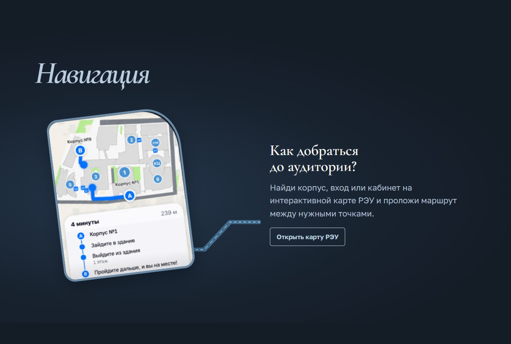
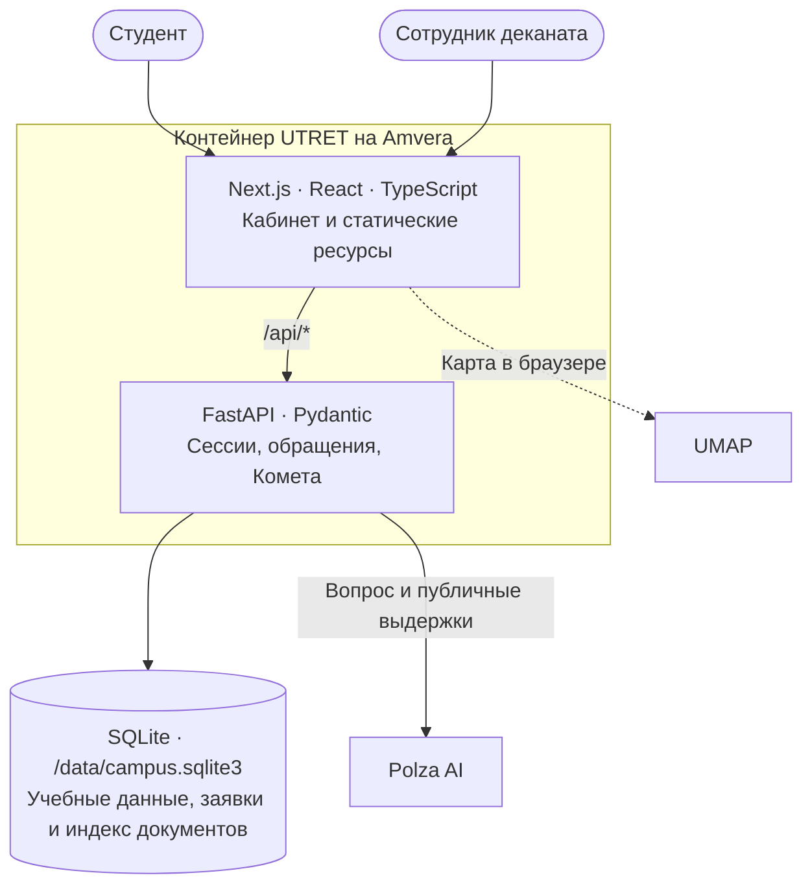
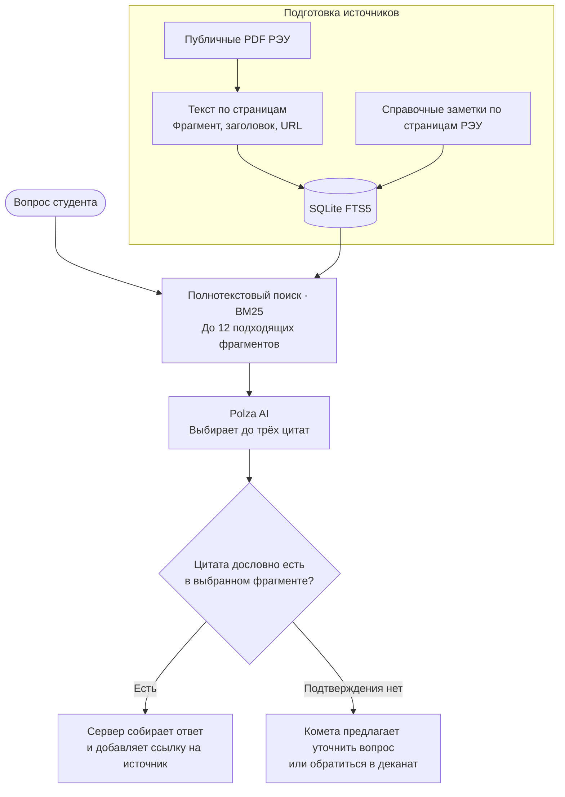
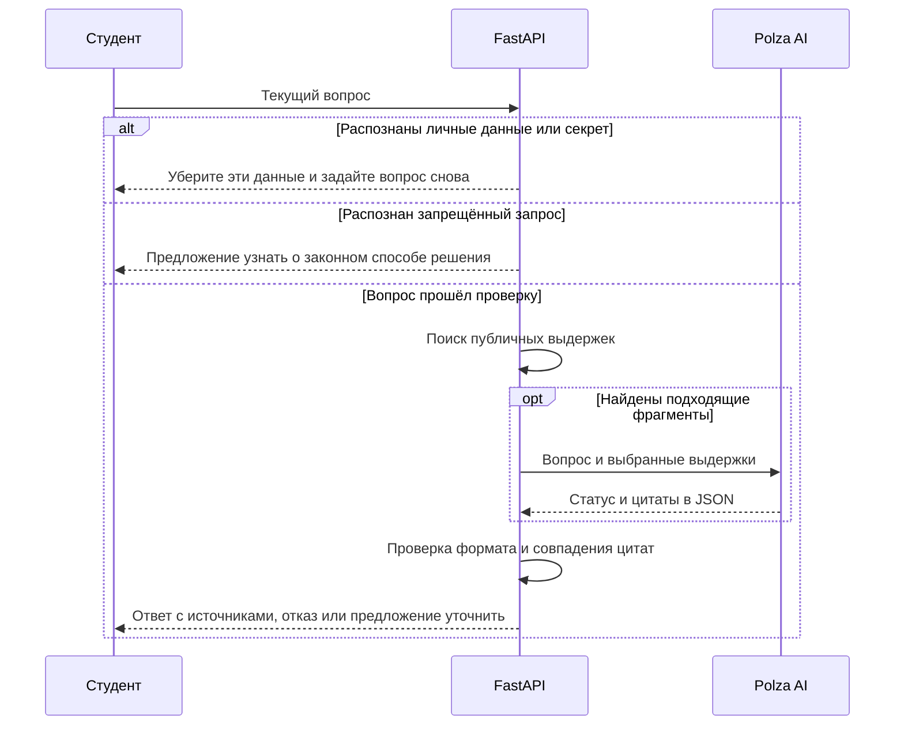
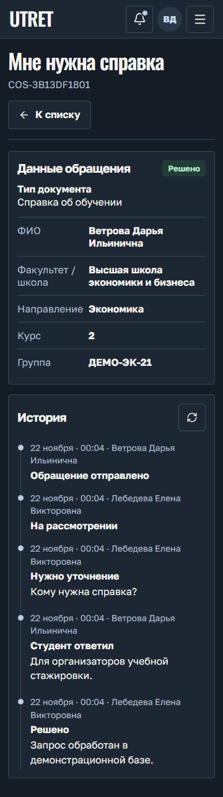

# UTRET

**Цифровой деканат команды DS CLUB.** Из расписания студент переходит к маршруту до аудитории, из уведомления о пересдаче открывает заявку с нужной дисциплиной, а у Кометы спрашивает о правилах вуза и открывает источник ответа.

[Прототип на Amvera](https://utret-ivan45646.mia0.amvera.tech/) · [Личный кабинет](https://utret-ivan45646.mia0.amvera.tech/lks) · [Образовательная вселенная](https://utret-ivan45646.mia0.amvera.tech/#education-universe) · [Отчёт команды](docs/contest/UTRET-contest-report.pdf)

[Системный дизайн](#системный-дизайн) · [RAG](#как-работает-rag) · [Этика Кометы](#этика-кометы) · [Локальный запуск](#локальный-запуск)

## Один кабинет для учебных дел

| С чего начинает студент | Куда ведёт кабинет |
| --- | --- |
| Открывает расписание | Видит пары, аудитории, преподавателей и переносы. Из расписания переходит к карте и копирует название аудитории для поиска маршрута в UMAP. |
| Проверяет успеваемость | Открывает зачётку, сессию и разбивку рейтинга по дисциплинам. Уведомление о пересдаче ведёт в форму с уже выбранной дисциплиной. |
| Заказывает справку | Выбирает тип справки и прикладывает фото подтверждающего документа в JPG или PNG до 3 МБ. После отправки получает номер и видит статус. |
| Получает вопрос от деканата | Открывает уведомление, отвечает в истории обращения и видит решение сотрудника. |
| Открывает профиль | Видит свои учебные данные, контакты и студенческий билет. |

### Образовательная вселенная

Мы представили учебную структуру как граф из **9 высших школ (факультетов), 14 узлов направлений, 19 программ, 377 дисциплин и 828 связей**. Общая дисциплина связывает программы, в которых её изучают. На телефоне можно коснуться узла, открыть его карточку, поворачивать сцену одним пальцем и менять масштаб двумя пальцами.

Один JSON питает сцену Three.js и HTML-список. В текущей сборке 3D-код и сжатые модели загружаются одним файлом, а граф подгружается параллельно. Список работает с теми же данными и доступен при отсутствии WebGL.


[Данные графа](campus-os-design-exploration/education-universe/data/education_universe.graph.json) · [Загрузчик сцены](campus-os-design-exploration/education-universe/universe.mjs)

### Карта кампуса

Мы интегрировали UMAP в кабинет. Карта открывается из расписания и показывает маршруты между корпусами. Чтобы адаптировать UTRET для другого вуза, можно использовать те же кабинеты студента и сотрудника, подставить свой учебный граф, расписание, карту и корпус документов, а правила обращений настроить под процессы вуза.



[Карта РЭУ в UMAP](https://in.umap.world/reu) · [Карта в кабинете](https://utret-ivan45646.mia0.amvera.tech/lks#app/campus)

## Системный дизайн

Кабинет и API работают на одном домене. В контейнере Amvera Next.js отдаёт интерфейс и статические ресурсы, а запросы `/api/*` передаёт FastAPI. Оба процесса запускаются вместе. FastAPI обращается к SQLite на постоянном диске и вызывает Polza AI для ответов Кометы.



| Решение | Как это работает |
| --- | --- |
| Один домен для клиента и API | Next.js принимает запросы на порту 3000. FastAPI слушает внутренний порт 8000. Сессия передаётся через cookie `HttpOnly`, `SameSite=Lax` и `Secure` в production. |
| Разрешения проверяет сервер | FastAPI определяет роль и владельца записи по сессии. Перед скачиванием файла проверяет доступ к заявке. Хеш пароля считается с помощью scrypt и индивидуальной соли. |
| Изменения по заявке сохраняются вместе | Сервер проверяет поля и фото, затем в одной транзакции сохраняет заявку, вложение, запись истории и уведомление. При повторной отправке с тем же ключом и данными возвращает существующую заявку. Смена статуса проверяет версию записи. |
| Данные переживают перезапуск | SQLite хранит обращения, вложения, сессии и индекс документов на томе `/data`. Конфигурация рассчитана на одну реплику. Черновик формы хранится в `sessionStorage`. После восстановления черновика фото выбирают заново. |
| Ключ модели находится на сервере | Polza AI вызывается из FastAPI. Ключ задаётся в окружении сервера. Клиент получает готовый ответ со ссылками. |

[Конфигурация Amvera](amvera.yaml) · [Запуск контейнера](amvera/start.sh) · [Сессии и роли](backend/campus/auth.py) · [Заявки и вложения](backend/campus/cases.py) · [OpenAPI](https://utret-ivan45646.mia0.amvera.tech/api/docs)

## Как работает RAG

Мы разработали поиск по публичным документам РЭУ и привязали каждый фрагмент к источнику. Импортёр извлекает текст из PDF по страницам. Индекс также содержит справочные заметки со ссылками на официальные страницы РЭУ.



Например, на вопрос **«Как получить справку об обучении?»** поиск подбирает фрагменты о справках. Модель возвращает номер фрагмента и его текст. FastAPI сверяет цитату с сохранённым фрагментом и берёт URL из базы. Для импортированного PDF ссылка открывает нужную страницу. Для справочной заметки ссылка ведёт на официальную страницу РЭУ.

[Открытые документы РЭУ](https://www.rea.ru/Sveden/document) · [Импорт PDF](backend/campus/rea_documents.py) · [Поиск по индексу](backend/campus/rag.py) · [Сборка ответа](backend/campus/assistant.py)

## Этика Кометы

Мы добавили в Комету этические правила. Помощник отвечает на вопросы об учебных процедурах, объясняет, куда обратиться, и предлагает законный путь, если запрос касается подделки, чужих данных или обхода проверок.



**Что получает модель.** Текущий вопрос, системные правила и выбранные публичные выдержки. Для модели вопрос и документы служат данными. Вызов проходит без истории переписки.

**Что проверяет FastAPI.** Сервер проверяет вход по распознаваемым шаблонам, разбирает JSON модели и сверяет текст цитаты. Такая проверка подтверждает происхождение цитаты. Применимость правила к конкретному случаю студент может сверить по ссылке. Если данных мало или модель возвращает неподтверждённый срок, Комета предлагает уточнить вопрос.

**Что проверили в коде.** Подставили ответ о справке «за пять минут» и убедились, что срок отсутствует в ответе. Отдельно проверили, что запросы на подделку и сообщения с распознанными персональными данными получают ответ до вызова внешней модели.

[Правила на входе](backend/campus/assistant_safety.py) · [Проверки ответа и безопасности](backend/tests/test_app.py) · [Комета в кабинете](https://utret-ivan45646.mia0.amvera.tech/lks#app/assistant)

## Как мы проверяли

Мы дали демодоступ **10 друзьям** и собрали обратную связь. Они рассказали, как за ответом на простые вопросы писали в дирекцию и открывали расписание, оценки и заявки в разных местах. По их замечаниям мы доработали кабинет.

На телефоне мы прошли путь справки от выбора документа и отправки до уточнения и решения деканата. После перезагрузки сверили номер, статус и переписку. Автоматические проверки охватывают загрузку фото, доступ к заявкам, черновики, пересдачи, цитаты Кометы и работу SQLite после перезапуска.



В процессе разработки мы собрали библиотеку вкусов из Pinterest и Twitter, сравнили пять вариантов обложки и вручную доработали выбранный. С помощью ИИ создали 3D-модели Образовательной вселенной. Команда спроектировала сценарии и правила работы с данными, а ИИ-ассистенты помогли с кодом и ревью.

[Процесс создания](docs/CONTEST_REPORT.md) · [Промпты ImageGen](docs/contest/AI_PROMPTS.md) · [Проверка по критериям](docs/contest/UTRET-criteria.pdf) · [Браузерные сценарии](frontend/tests)

## Локальный запуск

Понадобятся Node.js 24 и Python 3.12. Команды ниже рассчитаны на PowerShell.

```powershell
git clone https://github.com/mirovif/UTRET.git
Set-Location UTRET
py -3.12 -m venv .venv
.\.venv\Scripts\python.exe -m pip install -r backend/requirements-dev.txt
npm ci --prefix frontend
if (-not (Test-Path .env)) { Copy-Item .env.example .env }
```

Задайте `DEMO_PASSWORD` в локальном `.env`. В двух окнах запустите API и интерфейс из корня репозитория.

```powershell
.\.venv\Scripts\python.exe -m uvicorn app:app --app-dir backend --host 127.0.0.1 --port 8000
```

```powershell
npm run dev --prefix frontend
```

Откройте [локальный кабинет](http://localhost:3000/lks). При `DEMO_SEED=true` новые демонстрационные аккаунты `student1`, `student2`, `student3` и `staff` используют пароль из локального `.env`. Для локальной разработки предусмотрен режим `mock`. Опубликованная Комета использует Polza AI с серверным ключом.

Ветка `master` содержит актуальный код и документацию. Amvera развёртывается из ветки `amvera`. Текущая сборка сайта соответствует коммиту [4ec3364](https://github.com/mirovif/UTRET/commit/4ec33646acccaa1f9f94788c5d7953c5caea55cb). Учебные записи и обращения в демонстрационных аккаунтах вымышлены.

[Переменные Amvera и запуск Docker](amvera/README.md) · [Лицензии и сторонние материалы](docs/contest/THIRD_PARTY.md)
