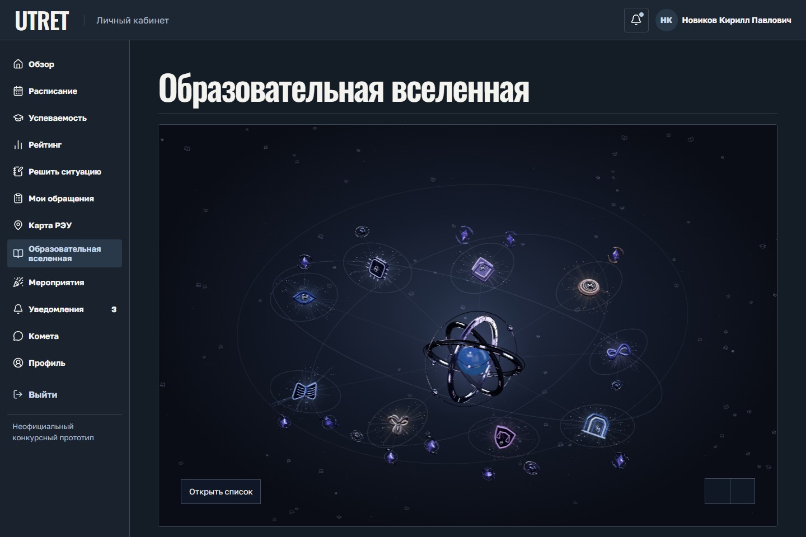
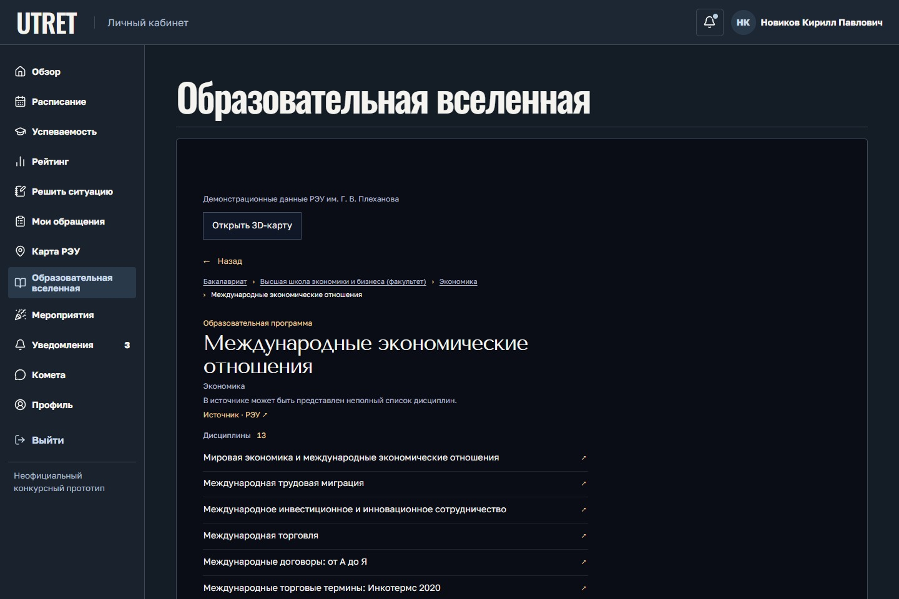
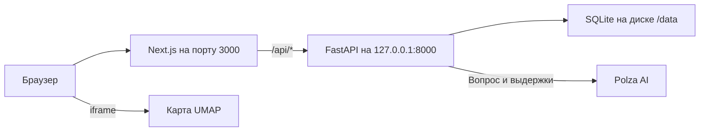

# UTRET

**Цифровой деканат команды DS CLUB.** Студент РЭУ может открыть расписание, посмотреть оценки, найти аудиторию и решить вопрос с деканатом из одного кабинета.

[Сайт на Amvera](https://utret-ivan45646.mia0.amvera.tech/) · [Личный кабинет](https://utret-ivan45646.mia0.amvera.tech/lks) · [Исходники сборки Amvera](https://github.com/mirovif/MGIMO-HACK/tree/amvera)

## Что мы придумали

Мы строили кабинет вокруг действий студента. Из расписания можно открыть карту кампуса. Напоминание о пересдаче ведёт в заявку с выбранной дисциплиной. Если сотрудник просит уточнение, студент получает уведомление и отвечает в истории обращения.

| Задача | Что доступно в кабинете |
| --- | --- |
| Начать учебный день | Расписание на день и неделю, аудитории, преподаватели, переносы и уведомления. |
| Проверить успеваемость | Зачётка, зачёты, сессия, рейтинг и разбивка баллов по дисциплинам. |
| Заказать справку | Выбор типа, обязательное фото подтверждения в JPG или PNG до 3 МБ, номер и статус. Для показа подходят тестовые фотографии без персональных данных. |
| Связаться с деканатом | Заявки о пропуске и пересдаче, общие вопросы, уточнения сотрудника и переписка. |
| Посмотреть свои данные | Учебный профиль, контакты и студенческий билет. |

### Образовательная вселенная

Мы представили структуру обучения как граф. Студент может перейти от школы или факультета к направлению, программе и дисциплинам. Если курс встречается в нескольких программах, этот же узел связывает их между собой.



В наборе РЭУ **9 высших школ (факультетов), 14 узлов направлений, 19 программ, 377 дисциплин и 828 связей**. Один JSON хранит узлы, рёбра и индексы. Three.js рисует сцену WebGL с моделями GLB. HTML-список использует тот же граф и позволяет пройти по тем же связям, в том числе без WebGL.

На телефоне можно коснуться узла, чтобы открыть его карточку, повернуть общий вид одним пальцем и приблизить его двумя пальцами или кнопками масштаба.



[Открыть вселенную в кабинете](https://utret-ivan45646.mia0.amvera.tech/lks#app/catalog) · [JSON графа](https://github.com/mirovif/MGIMO-HACK/blob/amvera/campus-os-design-exploration/education-universe/data/education_universe.graph.json)

### Навигация по кампусу

Мы интегрировали UMAP в UTRET. Из расписания или мероприятия студент может перейти к карте и скопировать название аудитории для поиска. Маршрут между корпусами строится в UMAP.


[Карта РЭУ в UMAP](https://in.umap.world/reu) · [Карта в кабинете](https://utret-ivan45646.mia0.amvera.tech/lks#app/campus)

Для другого вуза можно сохранить кабинеты студента и сотрудника, подставить свой граф программ, данные расписания, ссылку на карту и набор публичных документов. Справочники, правила обращений и структуру данных понадобится настроить под процессы этого вуза.

## Архитектура

На Amvera UTRET работает в одном контейнере. Next.js отдаёт обложку, собранный интерфейс, JavaScript и модели. Запросы с пути `/api/*` он передаёт в FastAPI. Для браузера сайт и API находятся на одном домене.



| Компонент | Реализация |
| --- | --- |
| Кабинеты | React, TypeScript и Next.js. Пошаговые формы, мобильная навигация, состояния загрузки, ошибки и пустые списки. |
| HTTP API | FastAPI и Pydantic. Маршруты профиля, расписания, успеваемости, заявок, уведомлений и Кометы. |
| Хранение | SQLAlchemy. SQLite хранит данные в файле `/data/campus.sqlite3` на постоянном диске Amvera. |
| Публикация | Docker собирает Next.js в standalone и запускает Node.js и Uvicorn. В `amvera.yaml` указаны порт 3000 и постоянный том `/data`. |

[OpenAPI](https://utret-ivan45646.mia0.amvera.tech/api/docs) · [Проверка состояния](https://utret-ivan45646.mia0.amvera.tech/api/health) · [Конфигурация Amvera](https://github.com/mirovif/MGIMO-HACK/blob/amvera/amvera.yaml)

### Что происходит при отправке заявки

Форма передаёт данные и фото как `multipart/form-data`. Сервер проверяет тип обращения, формат и размер вложения. Заявка, вложение, первая запись истории и уведомление сотрудника сохраняются в одной транзакции. С теми же данными и тем же ключом идемпотентности сервер возвращает уже созданную заявку. Для изменения статуса сервер проверяет версию записи, чтобы два сотрудника не перезаписали изменения друг друга.

Черновик сохраняет введённые поля в `sessionStorage`. После перезагрузки фото нужно выбрать снова. Отправленное вложение хранится в базе и скачивается из карточки заявки.

### Вход и доступ к данным

У студента и сотрудника разные разрешения. Сервер определяет пользователя по сессии. Для студента он выбирает профиль, оценки и обращения текущей учётной записи. Перед скачиванием файла проверяет доступ к самой заявке. Чужая заявка и её вложение для другого студента возвращают HTTP 404.

У пароля в базе хранится хеш **scrypt** с индивидуальной солью. После входа браузер получает cookie `HttpOnly`, `SameSite=Lax` и `Secure` в production. Сессия действует восемь часов, в базе хранится SHA-256 от её токена. Запросы на изменения с другого сайта блокируются проверкой origin. Ключ Polza задаётся в окружении сервера.

[Сессии и роли](https://github.com/mirovif/MGIMO-HACK/blob/amvera/backend/campus/auth.py) · [Обращения и вложения](https://github.com/mirovif/MGIMO-HACK/blob/amvera/backend/campus/cases.py) · [Схема базы](https://github.com/mirovif/MGIMO-HACK/blob/amvera/backend/campus/db.py)

### Как отвечает Комета

Мы разработали RAG для Кометы на открытых документах РЭУ. Наш импортёр извлекает текст PDF по страницам, сохраняет фрагменты и связывает их с источниками. Полнотекстовый поиск по документам работает через SQLite FTS5.

Мы добавили в Комету этические правила.

1. Сервер фильтрует запрос перед вызовом модели. Проверяет распознанные чувствительные данные, просьбы о подделке документов и попытки изменить роль помощника.
2. По вопросу выбираются релевантные фрагменты. Polza AI получает вопрос и эти выдержки. Модель возвращает структурированный список цитат.
3. Сервер проверяет, что дословная цитата есть в выбранном фрагменте, и сам подставляет ссылку. Если подходящих цитат нет, Комета сообщает, что ответ подтвердить не удалось.

В тесте мы подставили ответ модели о выдаче справки за пять минут. Сервер проверил цитату и сообщил, что подтверждённого ответа нет. Для локальных автотестов используется тестовый режим, опубликованная конфигурация рассчитана на Polza AI с ключом.

[Импорт документов](https://github.com/mirovif/MGIMO-HACK/blob/amvera/backend/campus/rea_documents.py) · [Проверка цитат](https://github.com/mirovif/MGIMO-HACK/blob/amvera/backend/campus/assistant.py) · [Комета в кабинете](https://utret-ivan45646.mia0.amvera.tech/lks#app/assistant) · [Открытые документы РЭУ](https://www.rea.ru/Sveden/document)

## Как проверяли

Чтобы проверить UTRET на реальных пользователях, мы дали демодоступ нашим друзьям и опросили **10 человек**. Они рассказали, что трудно быстро получить ответ и приходится писать на почту дирекции. Учебные данные находятся в разных местах, а привычный кабинет выглядит устаревшим и неинтересным. По их обратной связи мы доработали прототип. Для конкурсного показа подготовили отдельные демонстрационные профили и прошли сценарий справки с телефона. После перезагрузки у владельца сохранились номер, статус и переписка. Другой студент открыть заявку не смог.


На сборке `9e4e16c` прошли 20 серверных тестов с SQLite. Браузерные сценарии на ширине 360 пикселей покрывают вход, расписание, оценки, работу студента и сотрудника, пересдачи, черновики и обязательное фото справки. Отдельно проверяли обновление контейнера с предыдущей версией базы.

Мы собрали библиотеку вкусов из проектов, найденных в Pinterest и Twitter. По понравившимся работам сформулировали для ИИ требования к композиции, шрифтам и анимации. С ИИ мы подготовили пять вариантов обложки, вручную доработали выбранный и проверили его на телефоне. Мы спроектировали структуру кабинета, описали экраны, переходы и правила работы с данными. ИИ-ассистенты написали код по нашим требованиям, субагенты участвовали в ревью. Мы проверили в браузере черновики, рейтинг и заявки. С Grill Me сверяли требования конкурса с кодом и уточняли спорные места. С Superpowers планировали доработки, организовывали ревью и проверяли изменения тестами. Для вариантов обложки использовали ImageGen, Impeccable и Taste v2. С помощью ИИ мы генерировали 3D-модели для Образовательной вселенной. В отчёте показываем, как связали учебный профиль с документами, сохранили черновики и проверили ответы Кометы.

[Этапы создания и отчёт](https://github.com/mirovif/MGIMO-HACK/tree/master/docs) · [Промпты ImageGen](https://github.com/mirovif/MGIMO-HACK/blob/master/docs/contest/AI_PROMPTS.md) · [Проверка по критериям](https://github.com/mirovif/MGIMO-HACK/blob/master/docs/contest/UTRET-criteria.pdf) · [Браузерные тесты](https://github.com/mirovif/MGIMO-HACK/tree/amvera/frontend/tests)

## Локальный запуск

Для воспроизведения опубликованной версии выберите ветку `amvera`. Понадобятся Node.js 24 и Python 3.12.

```powershell
git clone -b amvera https://github.com/mirovif/MGIMO-HACK.git
Set-Location MGIMO-HACK
py -3.12 -m venv .venv
.\.venv\Scripts\python.exe -m pip install -r backend/requirements-dev.txt
npm ci --prefix frontend
if (-not (Test-Path .env)) { Copy-Item .env.example .env }
```

Укажите `DEMO_PASSWORD` в локальном `.env`. Из корня запустите API и интерфейс в двух отдельных окнах PowerShell.

```powershell
.\.venv\Scripts\python.exe -m uvicorn app:app --app-dir backend --host 127.0.0.1 --port 8000
```

```powershell
npm run dev --prefix frontend
```

Откройте [локальный кабинет](http://localhost:3000/lks). С `DEMO_SEED=true` новые локальные аккаунты `student1`, `student2`, `student3` и `staff` используют пароль из локальной переменной `DEMO_PASSWORD`. Доступы к опубликованному демо команда передаёт отдельно.

[Запуск Docker и переменные Amvera](https://github.com/mirovif/MGIMO-HACK/blob/amvera/amvera/README.md) · [Лицензии и сторонние материалы](https://github.com/mirovif/MGIMO-HACK/blob/master/docs/contest/THIRD_PARTY.md)

UTRET представляет собой конкурсный прототип. Учебные записи, оценки и обращения в демонстрационных кабинетах вымышлены.
