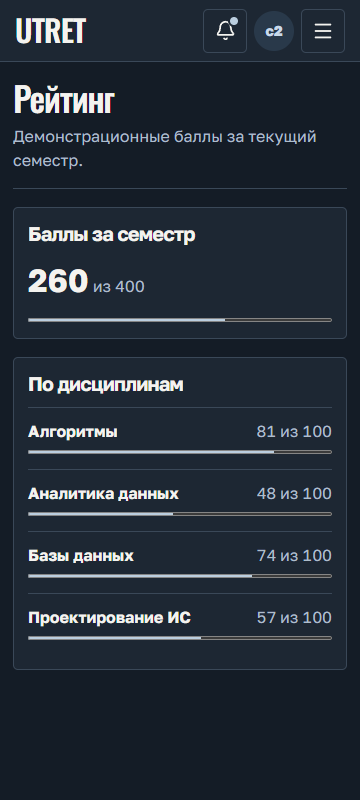

# UTRET · цифровой деканат

**Расписание, оценки и связь с деканатом в одном кабинете.**

Неофициальный конкурсный прототип для студентов РЭУ им. Г. В. Плеханова. В демо используются вымышленные учебные записи.

[Открыть кабинет](https://utret-campus.vercel.app/lks) · [Запасной адрес](https://utret-campus-demo.vercel.app/lks) · [Обложка UTRET](https://utret-campus.vercel.app/)

> Здесь хранится базовая конкурсная версия. Действующий кабинет обновлён до релиза `b233396`. Исходники этого релиза доступны команде отдельным архивом.

## Что показать жюри

| Задача | Маршрут | Результат |
| --- | --- | --- |
| Заказать справку | **Решить ситуацию → Мне нужна справка → Отправить обращение** | Номер и статус доступны в «Моих обращениях» после перезагрузки. |
| Ответить деканату | Сотрудник запрашивает уточнение. Студент открывает уведомление | Сообщения обеих сторон остаются в истории заявки. |
| Уточнить пересдачу | **Успеваемость → Зачётка → Уточнить условия пересдачи** | В заявке уже выбрана дисциплина. Переход работает и после даты экзамена. |
| Сверить данные | Войти вторым студентом в отдельном сеансе | У второго студента свой профиль, оценки и обращения. |

Для опубликованного кабинета используйте тестовые реквизиты, выданные командой.

## Что внутри

| Раздел | Возможности |
| --- | --- |
| Вход и профиль | Группа, факультет и направление, редактируемые контакты и демонстрационный студенческий билет |
| Расписание | День и неделя, аудитории, преподаватели и заметные переносы |
| Успеваемость | Зачётка, сессия, персональный рейтинг по дисциплинам |
| Обращения | Справки, пропуски, пересдачи и общие вопросы. Статусы, вложения и история |
| Уведомления | Изменения расписания, напоминания об аттестации и ответы сотрудника |

Карта кампуса открывается через UMAP. Образовательный каталог доступен списком и как интерактивный 3D-граф. Комета подбирает выдержки по учебным вопросам и показывает ссылки на источники.

[Карта кампуса](https://in.umap.world/reu) · [Документы РЭУ](https://www.rea.ru/Sveden/document)

## Мобильный кабинет



[Отчёт о создании базовой версии](docs/CONTEST_REPORT.md) · [PDF со скриншотами](docs/contest/UTRET-contest-report.pdf)

## Запуск на компьютере

Понадобятся **Node.js 20.9+** и **Python 3.12**. Выполните команды в PowerShell из корня проекта.

```powershell
py -3.12 -m venv .venv
.\.venv\Scripts\python.exe -m pip install -r backend/requirements-dev.txt
npm ci --prefix frontend
if (-not (Test-Path .env)) { Copy-Item .env.example .env }
```

Запустите API и интерфейс в двух терминалах из корня проекта.

```powershell
Set-Location backend
..\.venv\Scripts\python.exe -m uvicorn app:app --host 127.0.0.1 --port 8000
```

```powershell
npm run dev --prefix frontend
```

[Локальный кабинет](http://localhost:3000/lks) · [Описание API](http://localhost:3000/api/docs)

Локальные роли создаются при `DEMO_SEED=true`. Для `student1`, `student2` и `staff` по умолчанию используется тестовый пароль `Campus-demo-26`. Для Linux и macOS интерпретатор виртуального окружения находится по пути `.venv/bin/python`.

## Как устроен проект

| Каталог | Назначение |
| --- | --- |
| [frontend](frontend/) | Next.js, React и TypeScript. Кабинеты студента и сотрудника, пошаговые формы и мобильные тесты |
| [backend](backend/) | FastAPI, SQLAlchemy, сессии, расписание, обращения и поиск по документам |
| [campus-os-design-exploration](campus-os-design-exploration/) | Обложка UTRET, шрифты и образовательный каталог |
| [docs](docs/) | Материалы конкурса и история решений |

Браузер обращается к API на том же домене. Сервер проверяет сессию, роль и владельца записи. Пароли хешируются с солью через scrypt. SQLite используется локально, PostgreSQL — в опубликованной версии. Повторная отправка с тем же ключом возвращает существующую заявку. Изменение статуса сверяет версию записи.

В опубликованном UTRET Комета работает через Polza AI. API-ключ задаётся на сервере через `LLM_API_KEY`. Режим `AI_MODE=mock` предусмотрен для локальной разработки и тестов. В коде также поддерживается `AI_MODE=openrouter`. Команда `..\.venv\Scripts\python.exe -m campus.rea_documents --check` из `backend` проверяет извлечение из публичных PDF. Пример конфигурации хранится в [.env.example](.env.example).

## Проверки и развёртывание

Для браузерных тестов запустите оба сервиса с отдельной демонстрационной базой. Тесты создают заявки. Укажите `CAMPUS_TEST_POSTGRES` для дополнительного прогона на отдельной базе PostgreSQL.

```powershell
npm run build --prefix frontend
Push-Location backend
$env:LLM_API_KEY = 'fixture-only'
$env:LLM_MODEL = 'fixture-model'
..\.venv\Scripts\python.exe -m pytest -q --basetemp .campus-pytest
Pop-Location
Push-Location frontend
npx playwright install chromium
npm run test:e2e
Pop-Location
```

Публичный релиз проверен production-сборкой, 19 серверными тестами с отдельной PostgreSQL и 17 браузерными сценариями. Мобильные сценарии проверены на ширине 360 px, перенос длинного результата дополнительно проверен на 320 px.

Сервисы описаны в [vercel.json](vercel.json). Для опубликованного экземпляра нужны PostgreSQL и серверные настройки из [.env.example](.env.example). Релиз развёртывается через Vercel CLI из авторизованной рабочей копии.

Запускайте блок проверок в отдельном терминале. Значения `fixture-only` и `fixture-model` используются в тестах Кометы. Тестовый вызов модели подменён.
