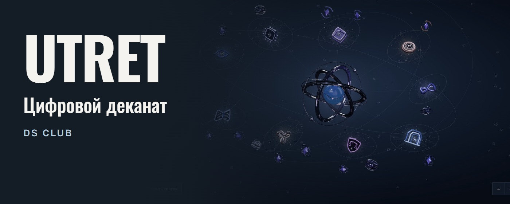
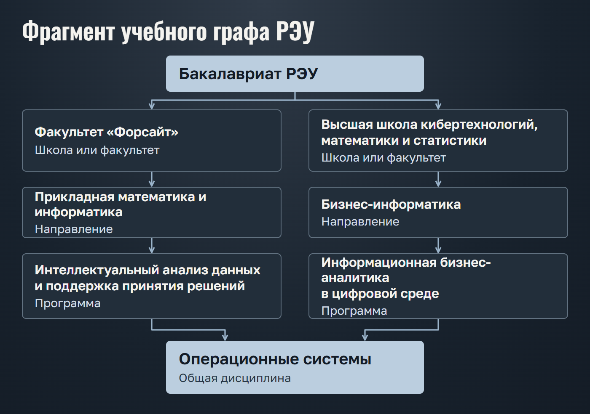

# UTRET

**Цифровой деканат команды DS CLUB.** В одном кабинете студент смотрит расписание и оценки, подаёт заявки и получает ответы деканата. Комета ищет ответы в открытых документах РЭУ, а Образовательная вселенная показывает связи между программами и дисциплинами.

[Открыть демо](https://utret-ivan45646.mia0.amvera.tech/) · [Личный кабинет](https://utret-ivan45646.mia0.amvera.tech/lks) · [Конкурсный отчёт PDF](docs/contest/UTRET-contest-report.pdf) · [Локальный запуск](#локальный-запуск)

[](https://utret-ivan45646.mia0.amvera.tech/#education-universe)

## Что показать в демо

| Сценарий | Что увидит студент |
| --- | --- |
| Найти аудиторию | Расписание на день и неделю, переносы и переход к карте. Название аудитории можно скопировать и найти маршрут в UMAP. |
| Проверить успеваемость | Зачётка, сессия и рейтинг по дисциплинам. Из уведомления о пересдаче открывается форма с нужной дисциплиной. |
| Заказать справку | Проверка ФИО из профиля, загрузка фото в JPG или PNG до 3 МБ, номер заявки и её статус. |


Деканат рассматривает заявку и сообщает решение. Если у сотрудника есть вопрос к данным или фото, он запрашивает уточнение. Ответ студента возвращает заявку на рассмотрение. В конкурсном прогоне на экране шириной 360 пикселей мы проверили этот случай и сверили номер, статус и переписку после перезагрузки. [Скриншоты прогона](docs/contest/evidence) · [Карта РЭУ в UMAP](https://in.umap.world/reu)

## Образовательная вселенная

В графе **9 школ и факультетов, 14 узлов направлений, 19 программ, 377 дисциплин и 828 связей**. В примере ниже две программы ведут к одной дисциплине «Операционные системы».



На телефоне нажмите на узел, чтобы открыть карточку. Одним пальцем можно повернуть сцену, двумя — приблизить. Сцена Three.js и список читают один JSON. Список доступен в браузере без WebGL. Данные отражают основные дисциплины со страниц программ РЭУ. [Открыть 3D-сцену](https://utret-ivan45646.mia0.amvera.tech/#education-universe) · [JSON графа](campus-os-design-exploration/education-universe/data/education_universe.graph.json)

## Архитектура


Next.js и FastAPI работают в одном контейнере Amvera. SQLite хранит заявки, вложения, сессии и индекс документов на томе `/data`. Конфигурация рассчитана на одну реплику. Сервер проверяет роль и доступ к каждой заявке и файлу.

Заявка, вложение, первая запись истории и уведомление сохраняются в одной транзакции. Повтор отправки с тем же ключом и данными возвращает ту же заявку. Перед сменой статуса сервер проверяет версию записи. Черновик хранится в текущей вкладке. При восстановлении черновика фото выбирают заново. [Конфигурация Amvera](amvera.yaml) · [Код обращений](backend/campus/cases.py) · [OpenAPI](https://utret-ivan45646.mia0.amvera.tech/api/docs)

## Как Комета отвечает по документам


Комета использует RAG по открытым документам РЭУ. Импортёр извлекает текст из публичных PDF РЭУ по страницам. В индекс также входят справочные заметки со ссылками на официальные страницы. По вопросу FastAPI ищет в SQLite FTS5 до 12 фрагментов. Polza AI выбирает до трёх цитат. Сервер сверяет их с сохранённым текстом и подставляет ссылки из базы. Если точной цитаты нет, Комета предлагает уточнить вопрос или обратиться в деканат.

Запрос к модели содержит текущий вопрос и найденные публичные выдержки. Если FastAPI распознаёт пароль, личные данные или запрещённый запрос, он отвечает до вызова модели. Код проверяет, что цитата есть в источнике. Применимость правила к конкретной ситуации можно сверить по ссылке. [Импорт PDF](backend/campus/rea_documents.py) · [Поиск](backend/campus/rag.py) · [Проверка цитат](backend/campus/assistant.py) · [Правила Кометы](backend/campus/assistant_safety.py)

## Проверки и материалы для жюри

Команда дала демодоступ 10 друзьям и доработала кабинет по их замечаниям. На конкурсной сборке `9e4e16c` команда прошла 20 серверных тестов с SQLite и 8 мобильных сценариев. Проверки охватывали доступ к заявке и фото, черновики, пересдачи, хранение после перезапуска и ответы Кометы. [Отчёт команды](docs/CONTEST_REPORT.md) · [Критерии конкурса](docs/contest/UTRET-criteria.pdf) · [Промпты ImageGen](docs/contest/AI_PROMPTS.md) · [Браузерные тесты](frontend/tests)

## Локальный запуск

Понадобятся Node.js 24 и Python 3.12. Команды рассчитаны на PowerShell.

```powershell
git clone https://github.com/mirovif/UTRET.git
Set-Location UTRET
py -3.12 -m venv .venv
.\.venv\Scripts\python.exe -m pip install -r backend/requirements-dev.txt
npm ci --prefix frontend
if (-not (Test-Path .env)) { Copy-Item .env.example .env }
```

Задайте `DEMO_PASSWORD` в локальном `.env`. Запустите API и интерфейс в двух терминалах из корня репозитория.

```powershell
.\.venv\Scripts\python.exe -m uvicorn app:app --app-dir backend --host 127.0.0.1 --port 8000
```

```powershell
npm run dev --prefix frontend
```

Откройте [локальный кабинет](http://localhost:3000/lks). При `DEMO_SEED=true` новые аккаунты `student1`, `student2`, `student3` и `staff` используют пароль из `.env`. В режиме `AI_MODE=mock` ключ модели не нужен. Доступы к опубликованному демо команда передаёт отдельно.

Конкурсная версия развёрнута из ветки `amvera`. Код в `master` соответствует сборке [4ec3364](https://github.com/mirovif/UTRET/commit/4ec33646acccaa1f9f94788c5d7953c5caea55cb) на Amvera. [Развёртывание и переменные окружения](amvera/README.md) · [Сторонние материалы](docs/contest/THIRD_PARTY.md)
