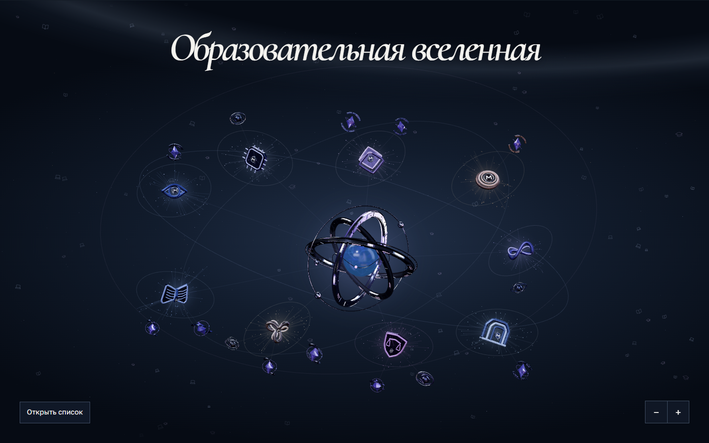
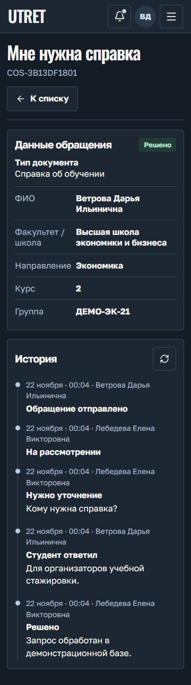
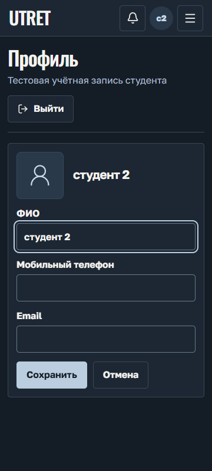
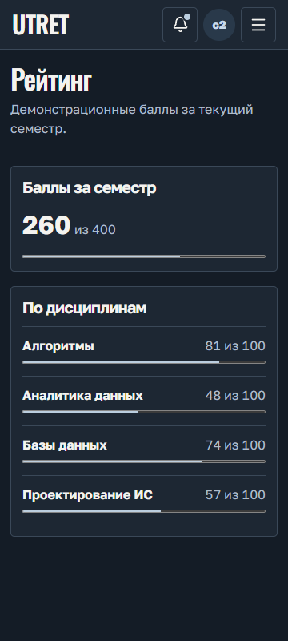

# UTRET

Конкурс «Цифровой деканат будущего». Команда DS CLUB, ноябрь 2026 года.

[Сайт на Amvera](https://utret-ivan45646.mia0.amvera.tech/) · [Личный кабинет](https://utret-ivan45646.mia0.amvera.tech/lks)

## Что мы сделали

Мы собрали учебные дела и связь с деканатом в одном кабинете. Студент может посмотреть расписание, открыть зачётку и подать заявку. Если сотруднику нужно уточнение, студент получает уведомление и отвечает в истории обращения.

Мы добавили студенческий билет в профиль и интегрировали UMAP. Из расписания можно перейти к карте, найти корпус или аудиторию и построить маршрут.

Для знакомства с программами мы придумали Образовательную вселенную. Это граф из 9 высших школ (факультетов), 14 узлов направлений, 19 программ, 377 дисциплин и 828 связей. От школы можно пройти к программе и увидеть её учебные курсы. Дисциплина, общая для нескольких программ, связывает их в графе. Мы показываем одни и те же данные в 3D и в списке.

На телефоне можно коснуться узла, чтобы открыть его карточку и увидеть связи. Общий вид поворачивается движением пальца, а масштаб можно менять двумя пальцами или кнопками «+» и «−». Так можно пройти от школы до конкретной дисциплины и посмотреть, в каких ещё программах её изучают.

<!-- next-page -->

## Как друзья пользовались кабинетом

Чтобы проверить UTRET на реальных пользователях, мы дали демодоступ нашим друзьям и опросили **10 человек**. Они воспользовались кабинетом и предложили, что улучшить. По их обратной связи мы доработали кабинет.

Друзья описали, как решали учебные вопросы раньше. Даже с простым вопросом они писали в дирекцию и ждали ответа. Расписание, оценки и заявки открывали в разных местах. Для этих задач им хотелось одного удобного и современного кабинета.

Для конкурсного показа подготовили отдельные демонстрационные профили и записали сценарий на телефоне.

Мы прошли весь путь заявки на справку на экране шириной 360 пикселей. В кабинете Дарьи выбрали справку об обучении и отправили заявку **COS-3B13DF1801**. В кабинете сотрудника уточнили, кому нужна справка. В кабинете студентки открыли уведомление и ответили, что документ нужен организаторам стажировки. Затем поставили статус «Решено».

После перезагрузки в кабинете сохранились номер заявки, статус и переписка. Мы проверили, что заявку видят её автор и сотрудник деканата. К заявке на справку студент прикладывает фото подтверждающего документа в JPG или PNG до 3 МБ. Загрузку фото мы проверили в браузере и через API.

<!-- next-page -->

## Как мы проектировали интерфейс

Мы собрали библиотеку вкусов. Смотрели проекты в Pinterest и Twitter, сохраняли понравившиеся работы и обсуждали, что именно нам нравится в их композиции, шрифтах и анимации. Затем описали эти приёмы в запросах к ИИ, чтобы получить варианты обложки UTRET. [Библиотека вкусов](https://github.com/mirovif/MGIMO-HACK/tree/design_library/design-inspiration-library)

Мы сравнили пять вариантов с одинаковым содержанием. Оценивали композицию и движение с помощью Impeccable и Taste v2. Выбрали пятый вариант, вручную доработали обложку и проверили её на телефоне.

Для ImageGen мы подготовили два запроса. Для кадра в атриуме мы попросили разместить студентов ближе к центру, чтобы они оставались в кадре при обрезке под экран телефона. Для мастерской задали три разных действия за одним столом, боковой свет и один цветовой акцент. Полные запросы сохранили в файле **AI_PROMPTS.md**.

С помощью ИИ мы генерировали 3D-модели для Образовательной вселенной. В сцене Three.js используем модели скульптуры, факультета и программы в формате GLB.

### Как мы связали профиль с документами

Мы спроектировали профиль как единый источник ФИО. FastAPI проверяет введённые данные, сохраняет их в SQLite и возвращает обновлённый профиль. React показывает это имя в студенческом билете и на экране проверки справки. При отправке сервер берёт ФИО из профиля текущего студента и сохраняет его вместе с заявкой.

Мы изменили имя в браузере, перезагрузили кабинет и сверили ФИО в профиле, билете и форме справки. [Код профиля](https://github.com/mirovif/MGIMO-HACK/blob/amvera/backend/campus/auth.py) · [Код заявки](https://github.com/mirovif/MGIMO-HACK/blob/amvera/backend/campus/cases.py)

<!-- next-page -->

## Рейтинг, черновики и пересдача

Мы спроектировали структуру кабинета, описали экраны, переходы и правила работы с данными. Выбрали Next.js, FastAPI и SQLite. ИИ-ассистенты написали код по нашим требованиям, субагенты участвовали в ревью. Мы проверили в браузере, как работают черновики, рейтинг и заявки.

### Как студент видит свои баллы

Мы сделали рейтинг доступным с плитки на «Обзоре» и из меню. На экране рейтинга студент видит общую сумму и баллы по каждой дисциплине. Мы открыли рейтинг обоими способами и сверили баллы двух демонстрационных профилей. У одного было 274 балла из 400, у другого 260. [Код и проверка](https://github.com/mirovif/MGIMO-HACK/commit/7ba8c51)

### Как сохраняется черновик

Мы предусмотрели отдельный черновик для каждого типа обращения. Для ревью передали субагенту сценарий переключения и пример прежнего формата хранения. В браузере мы сменили тип обращения, перезагрузили страницу и вернулись к исходному тексту.

### Как студент уточняет условия пересдачи

Мы связали уведомление о пересдаче с формой обращения. Для проверки открыли уведомление на телефоне и сверили, что кабинет подставил нужную дисциплину. [Код и проверка](https://github.com/mirovif/MGIMO-HACK/commit/3a0f715)

<!-- next-page -->

## Как мы разработали RAG для Кометы

Мы собрали открытые документы РЭУ и написали импортёр PDF. Он извлекает текст по страницам, разбивает его на фрагменты и сохраняет ссылки. По вопросу студента сервер ищет подходящие выдержки в полнотекстовом индексе SQLite FTS5 и передаёт их модели Polza AI.

Модель возвращает номера фрагментов и цитаты. Сервер сверяет их с документами и добавляет ссылки на страницы. Мы подставили выдуманный срок выдачи справки в пять минут. Комета предложила уточнить вопрос или обратиться в деканат. [Импорт PDF](https://github.com/mirovif/MGIMO-HACK/blob/amvera/backend/campus/rea_documents.py) · [Проверка цитат](https://github.com/mirovif/MGIMO-HACK/blob/amvera/backend/campus/assistant.py)

Мы добавили в Комету этические правила. При запросе на подделку, раскрытие чужих данных или обход проверки агент предлагает обсудить законное решение. Пароли и личные данные сервер отсеивает до вызова модели.

## Чем мы пользовались

| Инструмент | Как мы его использовали |
| --- | --- |
| Codex | ИИ писал код по сценариям и требованиям, которые мы спроектировали. |
| Grill Me | Разобрали спорные требования, сверили их с кодом и уточнили описание для жюри. |
| Superpowers | Разбили доработку на шаги, организовали ревью и проверили работу функций перед сдачей. |
| ImageGen, Impeccable и Taste v2 | Готовили иллюстрации, сравнивали варианты обложки, прорабатывали композицию. |
| Polza AI | Подключили модель для выбора цитат из найденных документов. |
| Playwright, Chromium, pytest и TypeScript | Проверяли мобильные сценарии, API и типы. |
| GitHub, Docker и Amvera | Хранили исходники, собирали и публиковали кабинет. |

## Как мы устроили доступ и хранение

На Amvera SQLite хранится на постоянном диске в `/data/campus.sqlite3`. Пароли храним в виде хешей с солью. Заявки и файлы доступны автору и сотруднику. На сборке `9e4e16c` прошли **20 серверных проверок** с SQLite и **8 мобильных сценариев**. Из России открыли кабинет без VPN.
