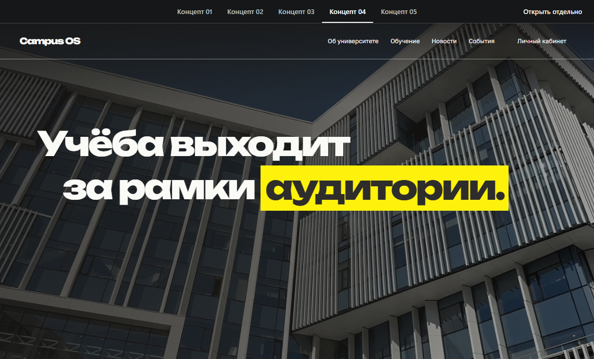
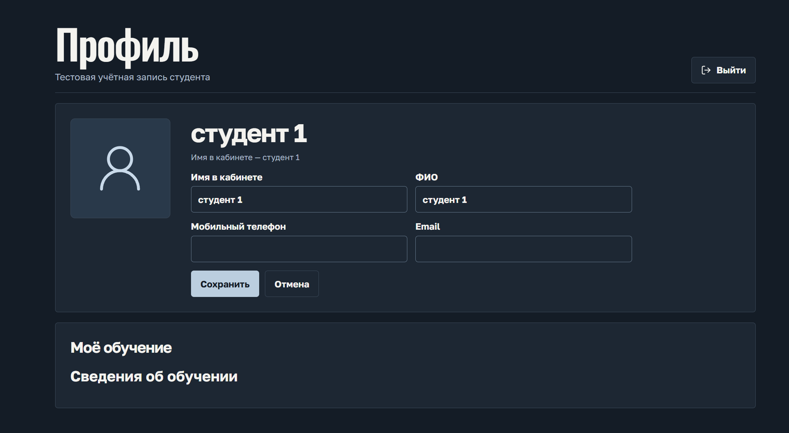

# UTRET — цифровой деканат будущего

Отчёт о создании конкурсного прототипа · 21 ноября 2026 года

[Открыть UTRET](https://utret-campus.vercel.app/) · [Перейти в личный кабинет](https://utret-campus.vercel.app/lks) · [Исходный код](https://github.com/mirovif/MGIMO-HACK/tree/master)

## Какую задачу решает UTRET

Студенту приходится искать расписание, оценки, изменения и порядок подачи заявлений в разных местах. UTRET объединяет эти задачи в кабинете. Обзор показывает ближайшие занятия и обращения. Расписание связывает пару с преподавателем и аудиторией, успеваемость показывает оценки, сессию и накопленные баллы, а уведомления связывают новости деканата и статус обращения с личным кабинетом.

В разделе «Решить ситуацию» студент начинает с понятной формулировки задачи — заболел, нужна пересдача, справка или ответ на вопрос. Форма запрашивает данные для выбранного случая. У заявки есть номер и история. Сотрудник может запросить уточнение, а студент получает сообщение и отвечает в том же обращении. Комета отвечает на типовые вопросы по опубликованным материалам РЭУ и показывает источники.

Задачи выбраны из условий конкурса и проверены на демонстрационных сценариях. Подтверждённых материалов интервью с однокурсниками в документации проекта нет.

## От концептов к работающему кабинету

Сначала разработали пять вариантов университетской главной в общей сравнительной оболочке. Она позволяла оценить цвета, типографику, композицию и поведение на узком экране при одном и том же содержании. Концепт 04 на иллюстрации ниже — один из ранних вариантов. «Личный кабинет» тогда был обозначением будущего перехода. В итоговую версию вошла другая композиция, концепт 05, а за кнопкой появился рабочий кабинет.

*Ранний вариант. Снимок локального просмотра исходников. Сравнение вариантов сохранено в репозитории.* [Концепты и принятые решения](../campus-os-design-exploration/DESIGN.md)

Кабинет проектировали для телефона от 360 px. Для образовательного каталога сохранили обычный список как самостоятельный путь к дисциплинам. 3D-граф загружается отдельно, по запросу на узких экранах, и каталог остаётся доступным при недоступности WebGL. Основное действие остаётся доступным на телефоне даже при слабом соединении.

## Как использовали ИИ

| Инструмент | Применение |
| --- | --- |
| Codex | Анализ сценариев, реализация интерфейса и API, диагностика ошибок. Ассистент сопоставлял изменения с обратной связью команды и писал регрессионные проверки. |
| Встроенный ImageGen | Оригинальные иллюстрации атриума и мастерской с вымышленными студентами для ранних дизайн-концептов. Происхождение изображений и полные запросы сохранены вместе с исходниками. |
| Polza AI | Интеграция для Кометы в продукте. Модель помогает найти подходящие фрагменты справочных материалов. |
| Playwright, Chromium, pytest, TypeScript | Проверка результатов работы ИИ на уровне браузера, API и типов. |
| Git, GitHub, Vercel | История подтверждённых изменений и публикация работающего прототипа. |

В запросе к ImageGen для атриума требовались два вымышленных студента в обычной одежде без брендов, естественные жесты и композиция, пригодная для портретной обрезки. Требование к зоне кадрирования сформулировали как «both adult subjects and their working hands within the central 45% for a portrait crop». Запрос исключал слова, вывески и логотипы. Отдельный запрос на мастерскую описывал три разные ручные операции вокруг общего макета, боковой дневной свет и один цветовой акцент. [Полные запросы и происхождение материалов](../campus-os-design-exploration/assets/SOURCES.md)

Код и визуальные решения проверялись по разным критериям. При работе над конкурсной версией ассистенты получили отдельные задачи по учебным данным, поведению черновиков и отчёту. Для данных было важно заполнить уже созданные аккаунты, сохранить редактируемые поля и проверить результат повторного заполнения. Для черновиков — удержать текст при переходе между типами заявок и сохранить совместимость с прежними черновиками. Эти условия проверяются по коду и тестам.

### Как исправили повторный ввод в профиле

Команда указала, что «в ФИО тоже имя есть». Первоначально ассистент проверил только сохранённые значения и оставил два поля для имени. Затем проверка обнаружила вторую проблему — сохранённое ФИО могло отличаться от имени в билете и новой заявке на справку.

Форма теперь содержит одно поле ФИО, телефон и email. Кабинет, билет и новые заявки получают имя из единого источника. Проверили сохранение и перезагрузку, длинное имя, экран 360 px и открытие ранее созданного черновика справки. [Изменение профиля и сценария справки](https://github.com/mirovif/MGIMO-HACK/commit/15c3c5d)

*До исправления. Скриншот участника из рабочей переписки показывает два поля для имени.*

*После исправления. Скриншот опубликованного кабинета при ширине 360 px.*

### Как отделили логин от отображаемого имени

В рабочем запросе команда указала «логины student1 и тд … 3 штуки всего». Ассистент сначала выдал случайные логины, затем изменил только имена на экране. После уточнения три публичные записи получили нужные логины. Уже занятые старые демо-логины архивировали под другими именами. Вход в каждую новую запись проверили отдельно. Пароли в отчёт не включены.

### Как проверили баллы в рейтинге

Команда попросила «вот тут рейтинг напиши и вкладку рейтинг добавь чтобы отслеживать сколько баллов сейчас». На обзоре появилась плитка «Рейтинг», в кабинете — отдельный экран с общей суммой и баллами по дисциплинам. Перед реализацией проверка подтвердила, что маршрута ещё нет. После реализации проверили обязательность входа и разные результаты для двух студентов. Опубликованную версию проверили для всех трёх аккаунтов на двух адресах. [Рейтинг и регрессионные тесты](https://github.com/mirovif/MGIMO-HACK/commit/7ba8c51)

*Итоговый сценарий накопленных баллов на экране 360 px. Все оценки вымышлены.*

### Как связали уведомления, расписание и обращение

Три демо-аккаунта получили разные учебные профили и зачётки. Дисциплины в расписании, зачётке и рейтинге совпадают. Уведомление об аттестации ведёт к датам сессии, а уведомление о пересдаче открывает заявку с выбранной дисциплиной. Черновики разных типов теперь сохраняются отдельно. Тесты прошли полный переход от уведомления до отправки обращения, а также смену типа заявки с сохранением черновика после перезагрузки. [Реализация и проверки](https://github.com/mirovif/MGIMO-HACK/commit/3a0f715)

*Локальный прогон итоговой сборки на ширине 360 px с вымышленными данными.*

### Что делала команда вручную

Участники формулировали задачи, выбирали визуальное направление, уточняли смысл логинов и отправляли скриншоты спорных экранов. Для профиля человек заметил повторный ввод, который ассистент пропустил. Для рейтинга команда показала место в интерфейсе и объяснила, что студенту важны текущие баллы. Команда предоставила исходное видео для визуальной разведки. Перечень инструментов отражает подтверждённые в истории проекта материалы.

## Как устроен прототип

Браузер загружает интерфейс Next.js с того же домена, где работает API на FastAPI. PostgreSQL хранит учебные данные, сессии, обращения, историю и уведомления. Для локального запуска используется SQLite. Доступ к данным определяется сервером по сессии. Параметры запроса из браузера не могут указать другого владельца. Сотрудники и студенты получают разные разрешения на действия с заявками.

Пароль пользователя хранится как хеш scrypt с солью. После входа браузер получает защищённую на публичном сайте сессионную cookie, недоступную JavaScript. В базе хранится хеш токена сессии. Повторную отправку одной заявки сервер объединяет по ключу запроса. Для одновременных обновлений проверяется версия записи и допустимость смены статуса.

Комета использует справочные материалы и проиндексированные публичные PDF РЭУ. Сервер сопоставляет текст ответа с документом и показывает использованные источники. Запросы с распознанными паролями, токенами или личными данными отсекаются до вызова модели. Ключ внешней модели находится в настройках сервера. Пример конфигурации не содержит рабочих секретов. [Архитектура и воспроизведение](../README.md)

## Как проверить результат

1. Открыть «Личный кабинет» и войти с выданным тестовым доступом. На телефоне открыть меню и проверить профиль, расписание, успеваемость и рейтинг.
2. Создать заявку на справку. Сверить номер и статус в «Моих обращениях» после перезагрузки. В кабинете сотрудника взять её на рассмотрение и запросить уточнение.
3. Ответить на уточнение из кабинета первого студента. В отдельной сессии второго студента убедиться, что его профиль, оценки и обращения отличаются.
4. Открыть Комету и задать вопрос о справке. Ответ, основанный на материале РЭУ, содержит ссылку на источник.

Прошли 8 браузерных сценариев на 360 px и 18 серверных тестов. Один отдельный серверный тест PostgreSQL пропущен без тестовой базы. В числе проверок — недоступность чужой заявки, повторная отправка, смена статусов, рейтинг и источники Кометы. Для конкурсной обложки оставили короткий архитектурный фрагмент без эмблем из предоставленного видео, а скриншот сторонней карты заменили собственной схемой. Страница входа ответила HTTP 200 на независимых узлах в Москве и Санкт-Петербурге. Такая проверка подтверждает доступность в момент замера с этих узлов. [Результаты проверки](https://check-host.net/check-report/599a8b17kfd4) · [Браузерные тесты](../frontend/tests/campus.spec.ts) · [Тесты API](../backend/tests/)
