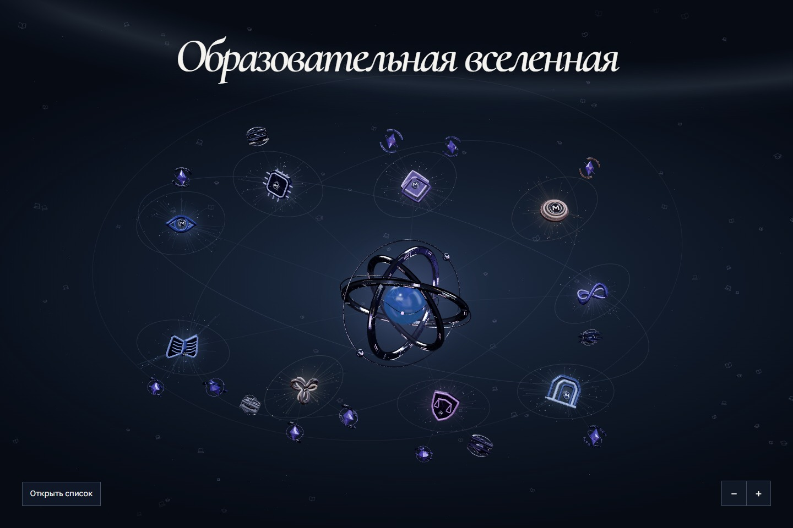
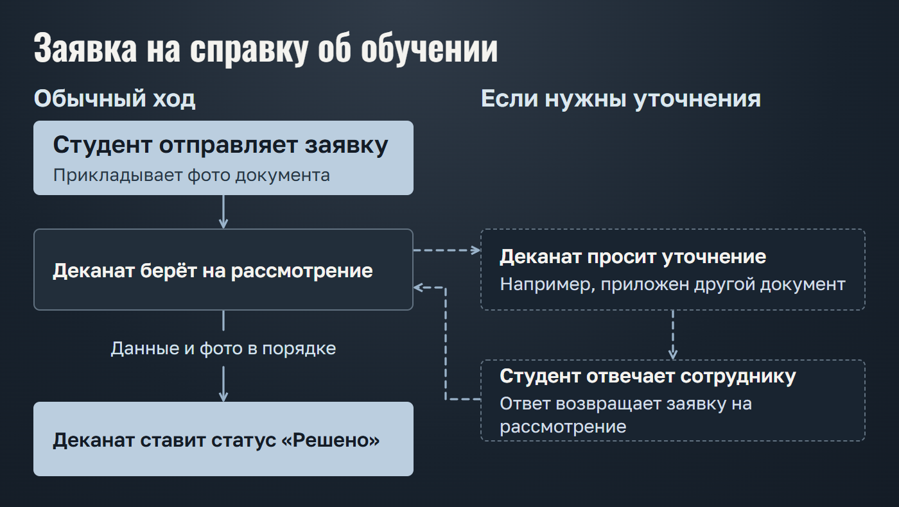
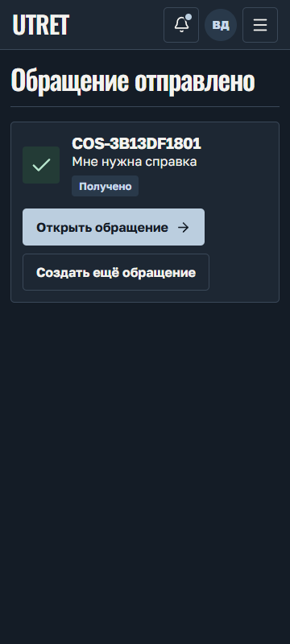
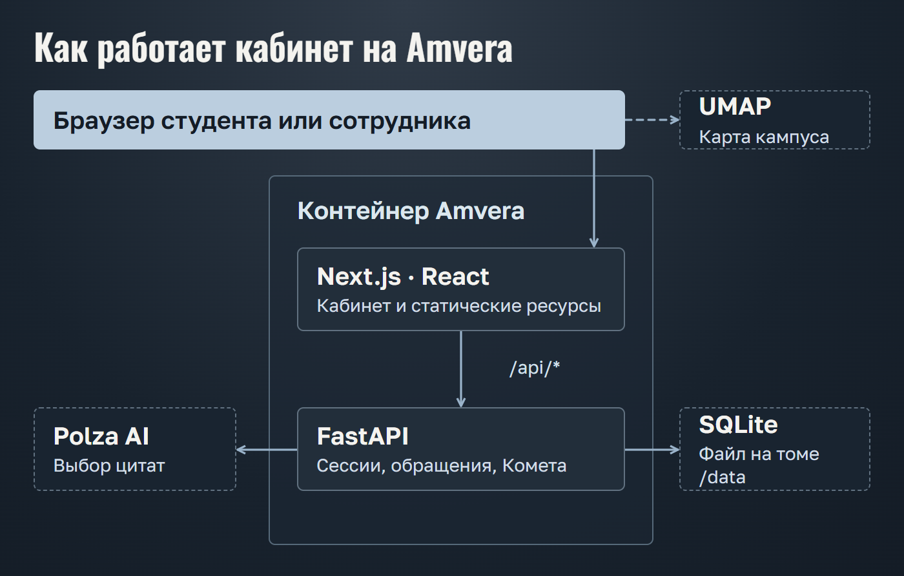
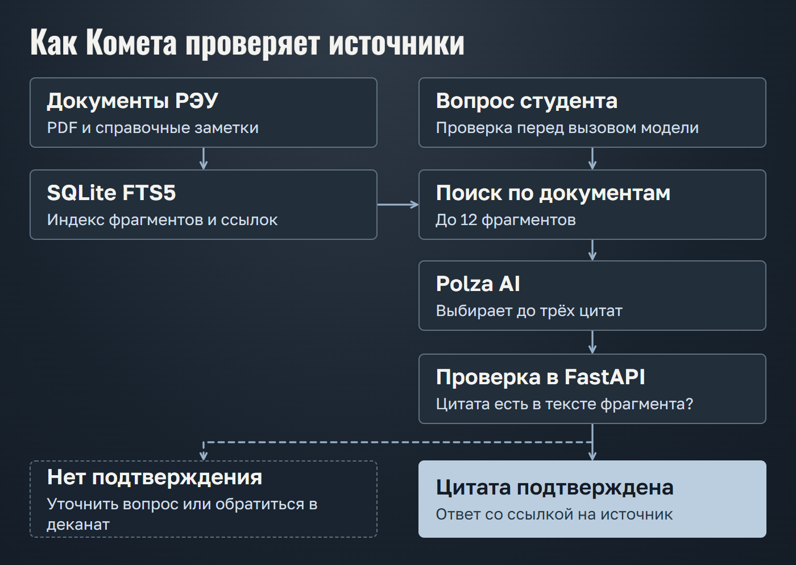
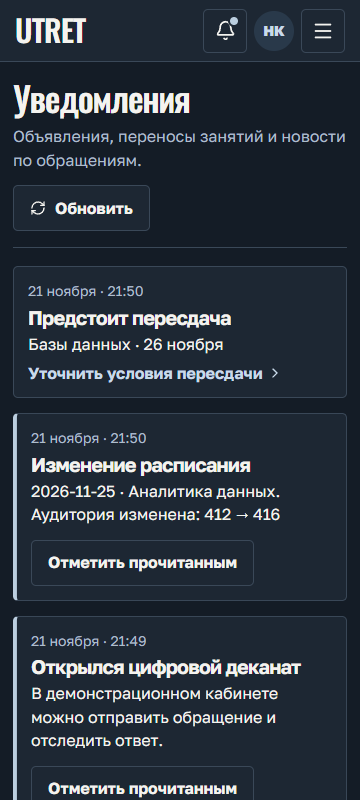

# UTRET

DS CLUB · НОЯБРЬ 2026

## Цифровой деканат

Конкурс «Цифровой деканат будущего»

Мы собрали расписание, успеваемость, студенческий билет и обращения в одном кабинете. Из расписания студент переходит к карте кампуса, из уведомления о пересдаче открывает форму с нужной дисциплиной, а по вопросу о правилах вуза получает у Кометы цитату со ссылкой.

<!-- next-page -->

## Образовательная вселенная

Студент может открыть школу, выбрать направление и программу, а затем посмотреть, какие дисциплины её связывают с другими программами. Ниже показан реальный фрагмент данных, где две программы включают «Операционные системы».

  
<strong>9</strong> школ и факультетов

  
<strong>14</strong> узлов направлений

  
<strong>19</strong> программ

  
<strong>377</strong> дисциплин

  
<strong>828</strong> связей

На телефоне карточка открывается касанием. Сцену можно повернуть одним пальцем и приблизить двумя. 3D-сцена Three.js и список читают один JSON. Если в браузере нет WebGL, доступен список.

Данные взяты со страниц программ РЭУ и охватывают основные дисциплины.

[Открыть сцену](https://utret-ivan45646.mia0.amvera.tech/#education-universe) · [Посмотреть данные графа](../campus-os-design-exploration/education-universe/data/education_universe.graph.json)

<!-- next-page -->

## Путь заявки на справку

Студент отправляет заявку с фото подтверждающего документа. Сотрудник рассматривает заявку и сообщает решение. Если у него есть вопрос к фото или данным, он запрашивает уточнение.

  <figure><figcaption>Проверка данных</figcaption></figure>
  <figure><figcaption>Номер заявки</figcaption></figure>
  <figure><figcaption>Решение деканата</figcaption></figure>

В конкурсном прогоне на экране шириной 360 пикселей сотрудник уточнил, кому нужна справка по заявке `COS-3B13DF1801`. Студентка ответила, и сотрудник закрыл заявку. Номер, статус и переписка сохранились после перезагрузки. Загрузку фото в JPG или PNG до 3 МБ проверили в браузере и через API.

<!-- next-page -->

## Как устроен кабинет

Next.js отдаёт кабинет и ресурсы главной. Запросы к `/api/*` он передаёт FastAPI. Оба процесса работают в одном контейнере Amvera. SQLite хранится на постоянном диске в `/data/campus.sqlite3`.

### Профиль и справка

FastAPI проверяет и сохраняет ФИО в профиле. React показывает имя в студенческом билете и на экране проверки справки. При отправке FastAPI берёт ФИО из профиля студента и записывает его в заявку. Мы изменили имя, перезагрузили кабинет и сверили ФИО во всех трёх местах.

### Доступ и история

FastAPI проверяет сессию, роль и владельца записи перед выдачей заявки или файла. Пароли хранятся в виде хешей scrypt с индивидуальной солью. Сервер сохраняет заявку, фото, запись истории и уведомление в одной транзакции. Повтор той же отправки возвращает существующую заявку.

[Запуск на Amvera](../amvera/README.md) · [Профиль и сессия](../backend/campus/auth.py) · [Заявки и вложения](../backend/campus/cases.py)

<!-- next-page -->

## Как Комета находит ответ

Комета использует RAG по открытым документам РЭУ. Импортёр извлекает текст PDF по страницам, сохраняет ссылки и добавляет фрагменты в полнотекстовый индекс. В индекс входят и справочные заметки со ссылками на сайт РЭУ.

Polza AI получает текущий вопрос и публичные выдержки. FastAPI принимает только цитаты, которые есть в сохранённых фрагментах, и берёт ссылки из базы. Для PDF ссылка открывает нужную страницу. Если подтверждения нет, Комета предлагает уточнить вопрос или обратиться в деканат.

Мы подставили в тесте выдуманный срок выдачи справки за пять минут. Сервер не включил срок в ответ. Отдельно проверили запросы о подделке и сообщения с распознанными личными данными. В обоих случаях FastAPI ответил до вызова модели.

[Официальные документы РЭУ](https://www.rea.ru/Sveden/document) · [Импорт PDF](../backend/campus/rea_documents.py) · [Проверка цитат](../backend/campus/assistant.py) · [Правила Кометы](../backend/campus/assistant_safety.py)

<!-- next-page -->

## Что мы проверили

Мы дали демодоступ 10 друзьям. Они рассказали, что за простыми ответами писали в дирекцию и открывали расписание, оценки и заявки в разных сервисах. По их замечаниям мы доработали кабинет.

  
<strong>10</strong> человек с демодоступом

  
<strong>20</strong> серверных тестов с SQLite

  
<strong>8</strong> мобильных сценариев

Серверные тесты и мобильные сценарии прошли на конкурсной сборке [9e4e16c](https://github.com/mirovif/UTRET/commit/9e4e16c). В браузере проверили, что уведомление о пересдаче подставляет дисциплину в форму, а после смены типа заявки и перезагрузки можно вернуться к нужному черновику. Сверили рейтинг двух демопрофилей. У одного было 274 балла из 400, у другого 260.

  <figure><figcaption>Рейтинг за семестр</figcaption></figure>
  <figure><figcaption>Уведомление о пересдаче</figcaption></figure>

### Как мы работали над интерфейсом

Собрали библиотеку примеров из Pinterest и Twitter, разбирали композицию, шрифты и анимацию. Сравнили пять вариантов обложки с помощью Impeccable и Taste v2. Пятый вариант доработали вручную и проверили на телефоне. Для сцены Three.js с помощью ИИ создали модели скульптуры, факультета и программы в формате GLB.

Команда спроектировала сценарии и правила работы с данными. Codex помог с кодом и ревью. С Grill Me разобрали требования конкурса, с Superpowers спланировали доработки. В браузере проверяли Playwright и Chromium, сервер тестировали через pytest, типы проверяли TypeScript. Сборку опубликовали через Docker и Amvera.

[Проверка по критериям](contest/UTRET-criteria.pdf) · [Промпты ImageGen](contest/AI_PROMPTS.md) · [Библиотека примеров](https://github.com/mirovif/UTRET/tree/design_library/design-inspiration-library) · [Браузерные тесты](../frontend/tests)
